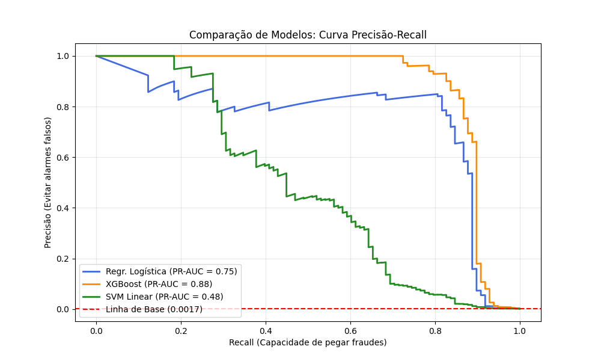
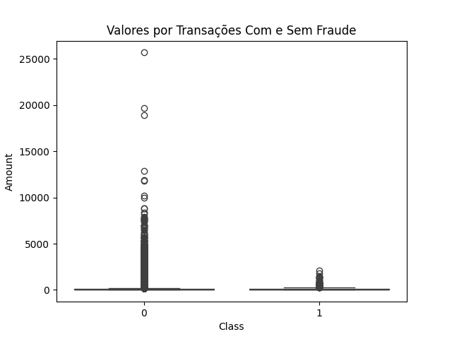
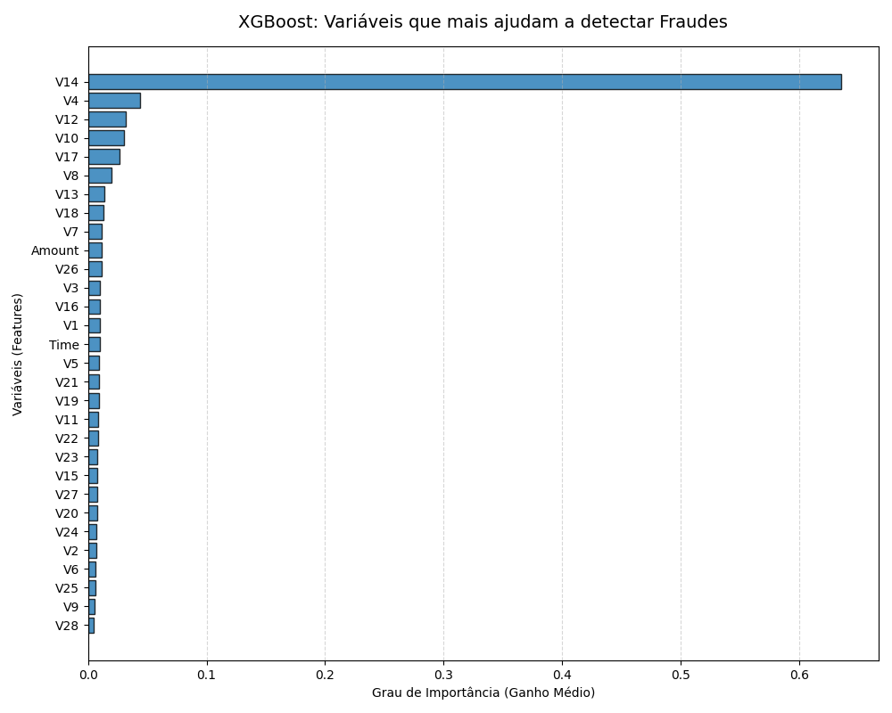

# Credit Card Fraud Detection with Machine Learning

*[Click here for the Portuguese version](README.md)*

This project was developed as the **Capstone Project** for the **Data Science Course** at **EBAC (British School of Creative Arts and Technology)**.

Note: During the development of certain stages—such as hyperparameter optimization and model calibration—I utilized artificial intelligence tools for support. I was also able to find efficient solutions for computational processing challenges (such as the SVM algorithm stalling), ensuring the application of best practices. The project structure, methodology, statistical analyses, and all written content—including explanations, justifications, and insights—are my own work.

* * *

### Project Objective

The goal of this project is to identify a machine learning model capable of detecting and enabling the blocking of fraudulent credit card transactions, while ensuring that legitimate customer transactions are not affected by false alarms.

* * *

### Methodology and Data Pipeline

The project workflow was structured around several key stages, including:

1.  **Proportional Splitting:** Data was split into training and testing sets using the `stratify` parameter, ensuring the original fraud proportions were maintained in both partitions.

2.  **Normalization:** The *Time* and *Amount* variables were standardized using `RobustScaler`. Distortions caused by outliers were mitigated by preserving the relative distances between data points.

3.  **Oversampling with SMOTE:** The significant class imbalance in the dataset was addressed using the SMOTE technique. A specific sampling limit of 20% was applied to generate new synthetic fraud cases, thereby avoiding a doubling of the already large original dataset's size.

4.  **Hyperparameter Optimization:** Searching for the best hyperparameters using `RandomizedSearchCV`, focusing on optimizing processing time through 3-fold cross-validation, limiting the number of iterations, and using the histogram-based method (`tree_method='hist'`).

* * *

### Tested Models and Results

Algorithm performance was evaluated on the imbalanced test set (simulating a real-world scenario). The resulting metrics are detailed below:

*   **XGBoost (Winner):** This model delivered the best balance, achieving **0.83 Precision** and **0.87 Recall**.

*   **Logistic Regression:** Achieved a high Recall rate (0.89) but a Precision of only 0.20, resulting in an excessive number of false positives.

*   **Linear SVM (SVC):** Low precision. The optimization process was capped at a maximum number of iterations (`max_iter=3000`). This early termination clearly hindered the model's performance.

* * *

### Model Tuning and Important Variables

*   **Flexible Threshold:** The XGBoost classification threshold was raised to prioritize legitimate customers and avoid blocking too many questionable transactions. A precision target of 90% was set, raising the probability threshold for fraud detection; while this reduced Recall, a reasonable rate of 84% was maintained.

*   **Feature Importance:** Assessment of each variable's importance based on the average gain across XGBoost trees.

* * *

### Files Generated for Production

Upon completion of the script, and to simulate a real-world production deployment scenario, I generated three files for loading:

*   `modelo_xgb.pkl`: the fitted model;
*   `robust_scaler.pkl`: the normalization file; *   `threshold_calibrado.pkl`: the defined optimal cutoff point.

* * *

### Featured Visualizations

*Note: This project was developed for academic and professional portfolio purposes.*
